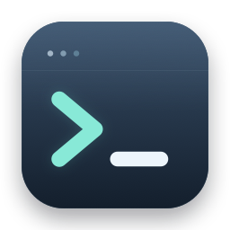
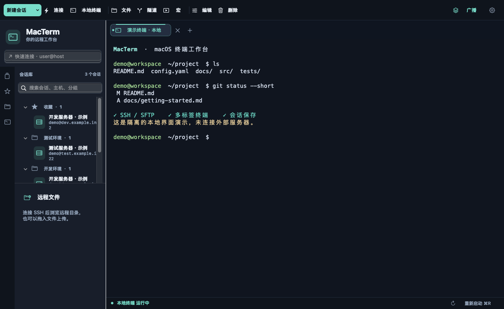
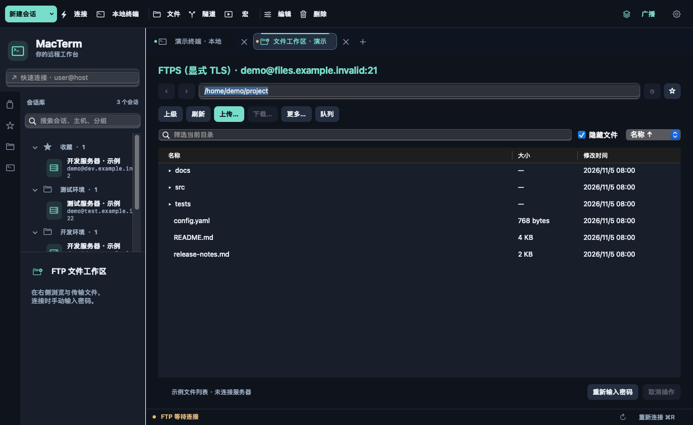
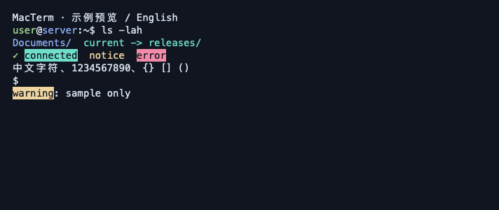

<p align="center"></p>

# MacTerm

面向 macOS 的轻量终端工作台。使用 AppKit、WebKit、xterm.js 与系统 OpenSSH，提供 SSH、多标签终端、会话管理和 SFTP 文件浏览 / 传输。

当前版本：**0.3.43**。基础功能已通过本机验证，仍欢迎提交实际使用反馈。此项目与 MacSCP 及其他同名项目独立，不包含 MobaXterm 的代码或商标资产。

## 功能

- 本地 shell、SSH 和多标签，支持会话保存、分组、导入导出、SSH config 导入与跳板机。
- 左侧 SFTP 文件浏览、上传下载、目录传输、传输队列、目录书签与远程文本编辑。
- 终端查找、主题 / 字号、输出日志、命令宏、广播、正则高亮与规则组。
- FTP / 显式与隐式 FTPS、串口、Telnet，以及内嵌 VNC / RDP 首版。
- 密码在连接时输入；本应用不持久保存密码或提供钥匙串自动填充。

## 界面展示

以下图片由独立演示进程生成，使用虚构会话、示例文件和本地终端，不包含私人服务器或真实用户数据。

### 多标签终端与会话库

顶部工具栏集中放置常用操作，左侧管理收藏、分组和保存的会话，右侧使用多标签终端。



### 文件工作区

支持浏览、筛选、上传下载和传输队列。下图为 FTP / FTPS 的示例列表；SSH 的 SFTP 文件浏览位于左侧会话区域下方。



### 终端高亮

可配置关键词或正则表达式、颜色和规则组，在保留原始终端文本的同时突出错误、警告与连接状态。



## 从源码构建

主要验证平台为 Apple Silicon Mac。部署目标为 macOS 12，Intel 和其他系统版本的兼容性仍需验证。需要 Apple Command Line Tools（含 Swift / clang）、Node.js 18 或更新版本、npm 和 Python 3；无需完整 Xcode。

```sh
npm ci
./build.sh
open build/MacTerm.app
```

首次构建会下载锁定版本的 FreeRDP、OpenSSL、cJSON，并在项目内准备 CMake，可能需要较长时间。下载地址和 SHA-256 在 `tools/fetch-rdp-deps.py` 固定。运行已构建的应用不需要 Node、Python 或系统 FreeRDP。

构建产物位于 `build.noindex/`，`build/` 为兼容入口，避免历史构建出现在 Spotlight 搜索中。应用使用本机临时签名，尚未进行 Developer ID 公证。

## 基础使用

1. 启动 App，点击新建 SSH 会话，填写主机、用户名和端口。
2. 在左侧双击会话连接；密码或私钥口令按 SSH 提示输入。
3. 登录成功后使用左侧 SFTP 文件栏浏览、上传或下载文件。
4. 添加其他会话会创建新标签；关闭应用前会提示未保存的编辑内容。

会话等用户数据保存在本机 `~/Library/Application Support/MacTerm/`，不属于本仓库。导出的会话或目录书签可能含服务器地址或工作路径，请自行检查后再分享。

## 验证

```sh
./test.sh
# 可选的完整本机 SSH / SFTP 端到端验证
python3 Tests/ssh_options_integration.py
# 可选的 FTP / FTPS 验证，需要独立虚拟环境安装测试依赖
python3 -m venv build/ftp-test-env
build/ftp-test-env/bin/pip install -r Tests/ftp-requirements.txt
build/ftp-test-env/bin/python Tests/ftp_integration.py
```

测试只针对临时回环服务和生成的数据，部分界面测试需要允许访问 macOS WebKit 等本机服务。不要把测试配置指向生产服务器。

## 已知限制

- 未集成 X Server / XDMCP；分屏暂非重点。
- 真实 Windows、更多远程服务器、输入法组合和 Finder 拖出仍需继续人工验证。
- FTP / FTPS 需要标准 MLSD 和 UTF-8；FTP 比较原内容与最终改名之间存在协议竞争窗口。
- RDP 首版不包含音频、磁盘 / 打印机重定向、网关或多显示器支持。

详细说明：[RDP](docs/RDP接入.md)、[VNC](docs/VNC接入.md)。

## 开源许可

Copyright (C) 2026 LeiSu-CASIA.

本项目原创代码按 **GPL-3.0-only** 发布，见 [LICENSE](LICENSE)。第三方组件保留各自许可证和版权，详见 [THIRD_PARTY_NOTICES.md](THIRD_PARTY_NOTICES.md)。
